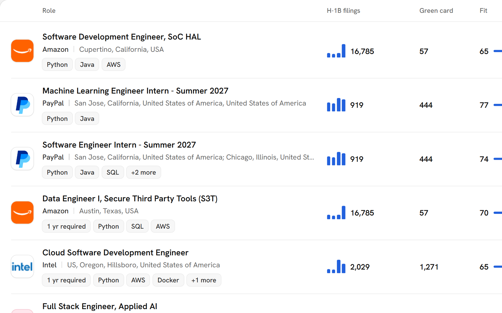
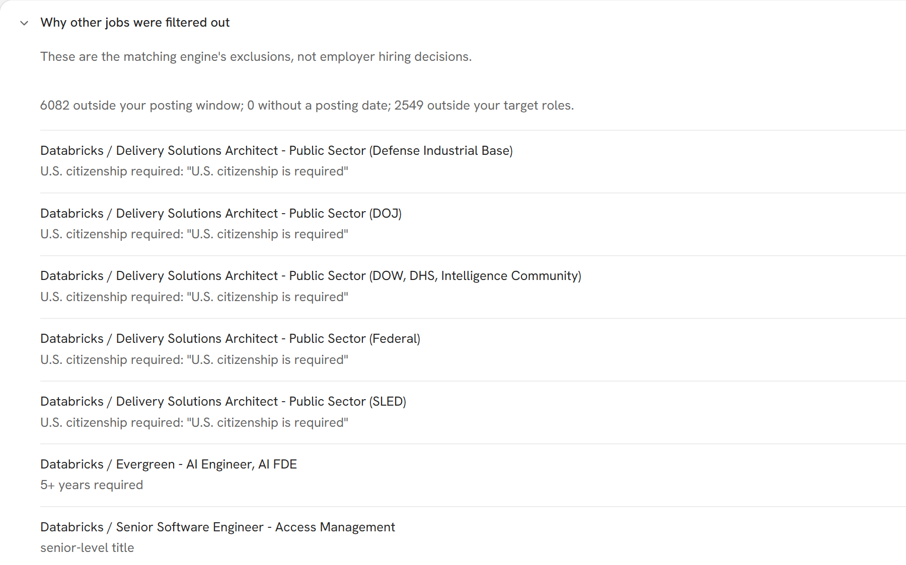
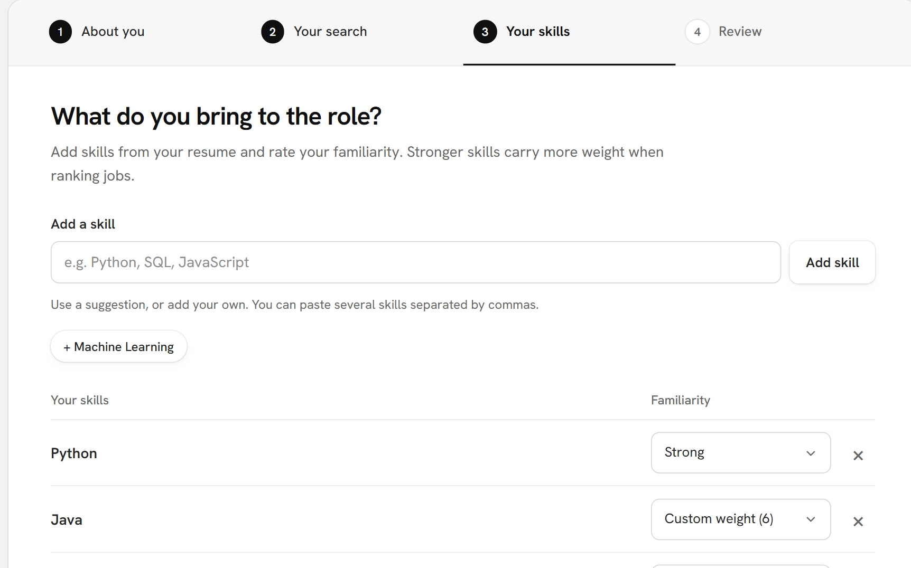

<p align="center">
  
</p>

<p align="center">
  <b>Current openings. Employer filing records. Your skills.</b><br>
  Together in one report, built around your search. Free, open source, and it runs on your computer.
</p>

<p align="center">
  <a href="#install">Install</a> &nbsp;&nbsp;|&nbsp;&nbsp;
  <a href="#quickstart">Quickstart</a> &nbsp;&nbsp;|&nbsp;&nbsp;
  <a href="docs/DASHBOARD.md">Dashboard guide</a> &nbsp;&nbsp;|&nbsp;&nbsp;
  <a href="docs/REFERENCE.md">Reference</a>
</p>

## How it works

SponsorScan joins two sources that cannot go stale on someone else's schedule:
the Department of Labor's quarterly LCA disclosure data (official, free, no API
key) and live postings served straight from employers' job boards. Then it
filters and ranks the results against your profile.

<table>
  <tr>
    <td width="33%" valign="top">
      <b>Check employer history</b><br>
      <sub>Past H-1B filings from Department of Labor disclosures, with green card filings alongside.</sub><br><br>
      
    </td>
    <td width="33%" valign="top">
      <b>Find current openings</b><br>
      <sub>Senior titles and requirements that conflict with your settings are filtered out, with the reason shown.</sub><br><br>
      
    </td>
    <td width="33%" valign="top">
      <b>Rank for your profile</b><br>
      <sub>Rate your skills and set your locations. Roles are ranked against them.</sub><br><br>
      
    </td>
  </tr>
</table>

Then, optionally, sync the results to Google Sheets, get new jobs by email or
Telegram, and run the whole thing on a schedule through GitHub Actions.

## Where the jobs come from

Public job boards on Greenhouse, Lever, Ashby, Workday and Eightfold, plus
Amazon's own job search, with no aggregator in between. `companies.yaml` covers
36 employers out of the box, including:

<table>
  <tr>
    <td align="center" width="14%"><br><sub>Stripe</sub></td>
    <td align="center" width="14%"><br><sub>NVIDIA</sub></td>
    <td align="center" width="14%"><br><sub>Databricks</sub></td>
    <td align="center" width="14%"><br><sub>Airbnb</sub></td>
    <td align="center" width="14%"><br><sub>DoorDash</sub></td>
    <td align="center" width="14%"><br><sub>Cloudflare</sub></td>
    <td align="center" width="14%"><br><sub>Netflix</sub></td>
  </tr>
  <tr>
    <td align="center"><br><sub>PayPal</sub></td>
    <td align="center"><br><sub>Intel</sub></td>
    <td align="center"><br><sub>Cisco</sub></td>
    <td align="center"><br><sub>GitLab</sub></td>
    <td align="center"><br><sub>Instacart</sub></td>
    <td align="center"><br><sub>Linear</sub></td>
    <td align="center"><br><sub>Mastercard</sub></td>
  </tr>
</table>

`discover` widens the list automatically when you want broader coverage, or add
any company that posts on those boards to `companies.yaml`.

**U.S. citizens and green card holders** can use it too: skip the filing-history
step and use it to filter entry-level roles at the employers you care about.

## Local dashboard

<p align="center">
  <picture>
    <source media="(prefers-color-scheme: dark)" srcset="assets/dashboard-dark.png">
    
  </picture>
</p>

After installing the dependencies below, start your personal workspace:

```bash
python sponsorscan.py dashboard
```

Your browser opens at **http://127.0.0.1:8765**. Create your profile in the
dashboard, fetch jobs, and save applications with statuses and notes. No hosted
account, Node.js installation, or frontend build is required.

- **Matches** shows each role with the employer's H-1B and green card filings,
  your profile fit, and the skills you matched. Open a role to see how its fit
  score breaks down and which skills the posting asks for that you lack.
- **Applications** keeps what you saved and where you applied, with notes.
- **Integrations** walks through Telegram, email, Google Sheets and a schedule,
  with commands you can copy into your terminal.
- Light and dark themes, following your system setting by default.

If you already have one personal profile in `profiles/`, it is selected
automatically. To choose a particular profile:

```bash
python sponsorscan.py dashboard --profile profiles/my_profile.json
```

Applications live in `.sponsorscan-dashboard/applications.sqlite3` and survive
job refreshes. A new dashboard profile is saved alongside them; an explicitly
selected existing profile is updated in place. The dashboard does not consume
email alert state or send email or Sheets updates. Those remain optional CLI
integrations. Press **Ctrl+C** in the terminal to stop the server.

See [the dashboard guide](docs/DASHBOARD.md) for first-run steps, backups,
alternate ports, and how local updates work.

## Install

### Before you start

You need three things:

- **Python 3.10 or newer.** Download it from <https://www.python.org/downloads/>.
  On Windows, tick **Add python.exe to PATH** on the installer's first screen.
  To check, run `python --version` (on macOS, `python3 --version`).
- **Git.** Download it from <https://git-scm.com/downloads>. If you'd rather not
  install it, open this repository on GitHub, click the green **Code** button,
  choose **Download ZIP**, unzip it, and skip the `git clone` line below.
- **A terminal**, where every command below is typed. On Windows, open the Start
  menu and type **PowerShell**. On macOS, open **Terminal** from Applications >
  Utilities.

`git clone` creates a `sponsorscan` folder inside whichever folder the terminal
is in. A new terminal starts in your user folder, so it ends up at
`C:\Users\<you>\sponsorscan` on Windows or `~/sponsorscan` on macOS. Every
command runs from that folder, and that is where the CSVs land.

Then clone the repository and create a virtual environment.

### Windows PowerShell

```powershell
git clone https://github.com/pruhnav/sponsorscan.git
cd sponsorscan

python -m venv .venv
Set-ExecutionPolicy -Scope Process Bypass
.\.venv\Scripts\Activate.ps1

python -m pip install --upgrade pip
pip install -r requirements.txt
```

The execution-policy change applies only to the current PowerShell window. When
you open a new terminal later, return to the repository and activate the
environment again:

```powershell
cd "$HOME\sponsorscan"
Set-ExecutionPolicy -Scope Process Bypass
.\.venv\Scripts\Activate.ps1
```

If you cloned somewhere else, `cd` to that folder instead. When the environment
is active, the prompt starts with `(.venv)`.

### macOS and Linux

```bash
git clone https://github.com/pruhnav/sponsorscan.git
cd sponsorscan

python3 -m venv .venv
source .venv/bin/activate

python -m pip install --upgrade pip
pip install -r requirements.txt
```

## Quickstart

Three commands from a clean clone to a CSV of matches. Every flag for every
command is documented in [docs/REFERENCE.md](docs/REFERENCE.md).

### 1. Load the sponsorship data

SponsorScan's sponsorship history comes from the DOL's quarterly **LCA Programs
(H-1B, H-1B1, E-3)** disclosure files. Each quarter, SponsorScan publishes the
employer table built from them, a few MB, so loading takes seconds:

```powershell
python sponsorscan.py load-lca --prebuilt --replace
```

U.S. citizens and permanent residents can skip this step. Their reports ignore
sponsorship history; see [docs/CITIZEN_SETUP.md](docs/CITIZEN_SETUP.md).

To build the table yourself straight from the DOL instead, which is a 100-400 MB
`.xlsx` download per quarter and a few minutes of loading:

```powershell
python sponsorscan.py load-lca --latest --replace
```

That resolves the newest file from the DOL site and downloads it. If the DOL
blocks the download or changes its page, download the file in a browser instead:

1. Open <https://www.dol.gov/agencies/eta/foreign-labor/performance>.
2. The page is long. Press `Ctrl+F` (`Cmd+F` on macOS) and search for
   **LCA Programs**.
3. Under that heading, click the newest disclosure file: the highest fiscal
   year, then the highest quarter, named like `LCA_Disclosure_Data_FY2026_Q4.xlsx`.
   Skip the record-layout PDF beside it.
4. It saves to your Downloads folder. Load it with the file's real name:

```powershell
python sponsorscan.py load-lca "$HOME\Downloads\LCA_Disclosure_Data_FY2026_Q2.xlsx" --replace
```

On macOS or Linux:

```bash
python sponsorscan.py load-lca ~/Downloads/LCA_Disclosure_Data_FY2026_Q2.xlsx --replace
```

This takes a few minutes. Re-run it when the DOL publishes a new quarterly file.

### 2. Pull live postings

```powershell
python sponsorscan.py fetch-jobs --replace
```

`companies.yaml` already ships with 32 confirmed job boards, so this
works immediately. There is no list to build first.

### 3. Generate the report

```powershell
python sponsorscan.py report --out matches.csv
```

The CSV lands in the `sponsorscan` folder your terminal is in. Open it with
`start matches.csv` on Windows or `open matches.csv` on macOS, or double-click
it in File Explorer or Finder. It opens in Excel, Numbers or Google Sheets.

### Optional: widen the company list

The shipped list is deliberately small. `discover` reads the employers loaded in
step 1, guesses job-board slugs from their legal names, probes all three
supported providers, and adds every confirmed board to `companies.yaml`:

```powershell
python sponsorscan.py discover
```

The first run can take a long time, because it may perform thousands of HTTP
probes. Results are cached in the database as they land, so `Ctrl+C` is safe and
a later run resumes from the cache. Skip this until you want broader coverage.

### Optional: personalize the report

```powershell
python sponsorscan.py setup
```

Asks a handful of questions - work authorization, target roles, skills,
locations - and writes a profile for you, instead of leaving you to hand-edit
25 JSON fields. You type your skills in; there is no resume file to upload. The
wizard shows which skill names the scorer recognises and flags any it will only
match literally. It saves your profile in the `profiles` folder inside
`sponsorscan`, named after the profile ID you chose, and ends by printing the
exact command for the personalized report. That report adds eligibility
filtering and ranking weighted by the skills you listed:

```powershell
python sponsor_daily_report.py --profile profiles/yours.json
```

Replace `yours` with your profile ID. The report writes two CSVs to the
`sponsorscan` folder, `<profile id>_matches_48h.csv` and
`<profile id>_new_jobs_48h.csv`.

### Something not working?

```powershell
python sponsorscan.py doctor
```

Checks every stage and names the one that needs attention, instead of leaving
you with an empty CSV and no explanation. Add `--profile profiles/yours.json`
to validate a profile at the same time.

## Extras

Each one is optional and skips itself until it is set up.

<table>
  <tr>
    <td width="25%" valign="top">
      <br>
      <b><a href="docs/EMAIL_SETUP.md">Email alerts</a></b><br>
      <sub>New matches sent from your own Gmail account.</sub>
    </td>
    <td width="25%" valign="top">
      <br>
      <b><a href="docs/TELEGRAM_SETUP.md">Telegram alerts</a></b><br>
      <sub>New matches as messages from your own Telegram bot.</sub>
    </td>
    <td width="25%" valign="top">
      <br>
      <b><a href="docs/GOOGLE_SHEETS_SETUP.md">Google Sheets</a></b><br>
      <sub>Both reports copied into a spreadsheet after each run.</sub>
    </td>
    <td width="25%" valign="top">
      <br>
      <b><a href="docs/REFERENCE.md#github-actions-automation">Run on a schedule</a></b><br>
      <sub>GitHub Actions runs the report for you through the day.</sub>
    </td>
  </tr>
</table>

## Where to go next

| You want | Read |
|---|---|
| Every command flag, the scoring table, and the caveats | [docs/REFERENCE.md](docs/REFERENCE.md) |
| A report ranked against the skills you list and your eligibility | [docs/REFERENCE.md](docs/REFERENCE.md#personalized-reporting) |
| Setup for OPT or STEM OPT | [docs/OPT_SETUP.md](docs/OPT_SETUP.md) |
| Setup for U.S. citizens | [docs/CITIZEN_SETUP.md](docs/CITIZEN_SETUP.md) |
| The local dashboard, its backups and ports | [docs/DASHBOARD.md](docs/DASHBOARD.md) |
| Help from an AI coding assistant | Open the repository in Claude Code, Codex, Cursor or Copilot and ask it to set things up. [AGENTS.md](AGENTS.md) tells it how. |

## Before you run it

<details open>
<summary><b>Does filing history mean an employer will sponsor me?</b></summary><br>

No. Filings record what an employer did in the past, not a promise for a
particular role or applicant, and employer name matching can be imperfect. Use
them to decide where to look first: an employer with recent filings, many of
them for new hires, is a better bet than one with a single old filing. Confirm
with the employer before you rely on it, and read the
[caveats](docs/REFERENCE.md#caveats-read-these).

</details>

<details>
<summary><b>What do the H-1B numbers count?</b></summary><br>

Certified Labor Condition Applications from the Department of Labor, the step an
employer completes before filing an H-1B petition. A certified filing is not an
approved visa, and one filing can cover more than one worker. SponsorScan also
counts how many were for new hires rather than extensions. Stripe, LLC, for
example, had 319 certified filings from FY2025 Q4 to FY2026 Q3, and 123 of them
were for new hires.

</details>

<details>
<summary><b>Does anything leave my computer?</b></summary><br>

There is no account and no SponsorScan server. It runs on your computer and goes
online only to fetch jobs, filing data and company logos. Your profile and
applications stay in local files. If you turn on email, Telegram, Google Sheets
or the GitHub Actions schedule, your results go only to the accounts you set up.

</details>

<details>
<summary><b>I'm a citizen or green card holder. Is it useful for me?</b></summary><br>

Yes. Skip the filing-history step and use it to filter entry-level roles at the
employers you care about. The [citizen guide](docs/CITIZEN_SETUP.md) covers the
setup.

</details>

<details>
<summary><b>Is it free?</b></summary><br>

Yes. SponsorScan is open source under the MIT license and uses public data, with
no API keys or paid services required.

</details>

<br>

<p align="center">
  
</p>

<p align="center">
  Built by <a href="https://github.com/pruhnav">Pranav Balachander</a> &nbsp;&nbsp;|&nbsp;&nbsp;
  <a href="https://www.linkedin.com/in/pranavbalachander2/">LinkedIn</a> &nbsp;&nbsp;|&nbsp;&nbsp;
  <a href="LICENSE">MIT license</a>
</p>
