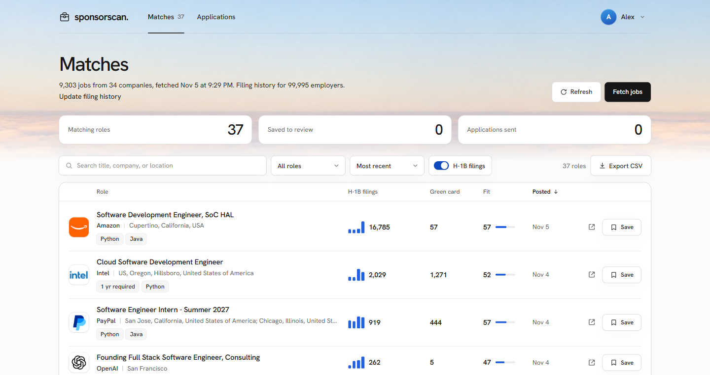

<p align="center">
  
</p>

<p align="center">
  A free, open-source job search for international students. It finds entry-level
  openings on employers' own job boards and shows each employer's H-1B and green
  card filing history beside them.
</p>

<p align="center">
  <a href="https://sponsorscan.pages.dev">Website</a> &nbsp;|&nbsp;
  <a href="#quick-start">Quick start</a> &nbsp;|&nbsp;
  <a href="docs/DASHBOARD.md">Dashboard guide</a> &nbsp;|&nbsp;
  <a href="docs/REFERENCE.md">Reference</a>
</p>

<p align="center">
  <a href="https://github.com/sponsorscan/sponsorscan/actions/workflows/tests.yml"></a>
  <a href="LICENSE"></a>
  
</p>

<picture>
  <source media="(prefers-color-scheme: dark)" srcset="assets/dashboard-dark.png">
  
</picture>

## What it does

- **Finds current openings at the source.** Postings come straight from
  employers' job boards on Greenhouse, Lever, Ashby and Workday, plus Amazon's and
  Microsoft's career sites. 36 employers ship by default, and `discover` finds
  more.
- **Shows who has sponsored before.** For each employer: certified H-1B filings
  by quarter, how many were for new hires, and green card (PERM) filings, from the
  Department of Labor's public disclosure data.
- **Ranks jobs for you, and shows its work.** Roles are scored on your target
  roles and skills, the career level, the company and its filing history. Open
  any job to see how its score adds up.
- **Leaves out what you can't apply for.** Senior titles, more years of
  experience than you allow, and postings that require U.S. citizenship are
  filtered out, each with its reason.
- **Keeps your search in one place.** A local dashboard to save roles and track
  applications, plus optional alerts by email or Telegram, a Google Sheet, and a
  schedule on GitHub Actions.
- **Runs on your computer.** No account and no SponsorScan server. It goes
  online only to fetch jobs, filing data and company logos.

## Quick start

You need **Python 3.10 or newer** ([download](https://www.python.org/downloads/);
on Windows, tick **Add python.exe to PATH** in the installer) and **Git**
([download](https://git-scm.com/downloads)). Type the commands into a terminal:
PowerShell on Windows, Terminal on macOS.

<details open>
<summary><b>Windows (PowerShell)</b></summary>

```powershell
git clone https://github.com/sponsorscan/sponsorscan.git
cd sponsorscan
python -m venv .venv
Set-ExecutionPolicy -Scope Process Bypass
.\.venv\Scripts\Activate.ps1
pip install -r requirements.txt
python sponsorscan.py dashboard
```

</details>

<details>
<summary><b>macOS and Linux</b></summary>

```bash
git clone https://github.com/sponsorscan/sponsorscan.git
cd sponsorscan
python3 -m venv .venv
source .venv/bin/activate
pip install -r requirements.txt
python sponsorscan.py dashboard
```

</details>

The dashboard opens in your browser at **http://127.0.0.1:8765**. Then:

1. **Create your profile:** your work authorization, target roles, skills and
   locations. It stays on your computer.
2. Click **Fetch jobs** to collect current postings, and **Load filing history**
   for each employer's filings. U.S. citizens and permanent residents can skip
   the history.
3. **Open a role** to see why it matched, then save it and track your
   application.

To start it again later, open a terminal in the `sponsorscan` folder, activate
the environment (`.\.venv\Scripts\Activate.ps1` on Windows,
`source .venv/bin/activate` elsewhere) and run `python sponsorscan.py dashboard`.

If something isn't working, `python sponsorscan.py doctor` checks every step and
names the one that needs attention.

### Prefer a spreadsheet?

The same search runs from the command line and writes a CSV that opens in Excel,
Numbers or Google Sheets:

```bash
python sponsorscan.py load-lca --prebuilt --replace   # filing history; skip if you don't need sponsorship
python sponsorscan.py fetch-jobs --replace            # current postings
python sponsorscan.py report --out matches.csv        # ranked matches
```

`python sponsorscan.py setup` builds a profile in a few questions, for a report
ranked against your own skills. See
[personalized reporting](docs/REFERENCE.md#personalized-reporting).

## Where the data comes from

| | Source | Updated |
|---|---|---|
| **Job postings** | Employers' own job boards (Greenhouse, Lever, Ashby, Workday, Eightfold) and Amazon's job search, with no aggregator in between | Each time you fetch |
| **H-1B filings** | Department of Labor LCA disclosure data | Each quarter, published to this repository's [`lca-latest` release](https://github.com/sponsorscan/sponsorscan/releases/tag/lca-latest) |
| **Green card filings** | Department of Labor PERM disclosure data | Each quarter, with the H-1B filings |

Filings show what an employer did before, not a promise for a particular role.
Check with the employer before you count on it. The
[caveats](docs/REFERENCE.md#caveats-read-these) cover the limits of the data, and
you can [load the DOL files yourself](docs/REFERENCE.md#1-get-the-lca-data)
instead of the prebuilt table.

## Extras

Each one is optional, and each skips itself until it is set up.

<table>
  <tr>
    <td width="25%" valign="top">
      <br>
      <b><a href="docs/EMAIL_SETUP.md">Email alerts</a></b><br>
      <sub>New matches sent from your own Gmail account.</sub>
    </td>
    <td width="25%" valign="top">
      <br>
      <b><a href="docs/TELEGRAM_SETUP.md">Telegram alerts</a></b><br>
      <sub>New matches as messages from your own Telegram bot.</sub>
    </td>
    <td width="25%" valign="top">
      <br>
      <b><a href="docs/GOOGLE_SHEETS_SETUP.md">Google Sheets</a></b><br>
      <sub>Your matches copied into a spreadsheet after each run.</sub>
    </td>
    <td width="25%" valign="top">
      <br>
      <b><a href="docs/REFERENCE.md#github-actions-automation">Run on a schedule</a></b><br>
      <sub>GitHub Actions runs the search for you through the day.</sub>
    </td>
  </tr>
</table>

## Documentation

| You want | Read |
|---|---|
| The dashboard: each page, backups and ports | [docs/DASHBOARD.md](docs/DASHBOARD.md) |
| Every command and flag, the scoring and the caveats | [docs/REFERENCE.md](docs/REFERENCE.md) |
| Setup for OPT or STEM OPT | [docs/OPT_SETUP.md](docs/OPT_SETUP.md) |
| Setup for U.S. citizens and permanent residents | [docs/CITIZEN_SETUP.md](docs/CITIZEN_SETUP.md) |
| Help from an AI coding assistant | Open the repository in Claude Code, Codex, Cursor or Copilot and ask it to set things up. [AGENTS.md](AGENTS.md) tells it how. |

## Contributing

Issues and pull requests are welcome, including new company boards for
`companies.yaml`. Read [CONTRIBUTING.md](CONTRIBUTING.md) before opening a pull
request. Report security issues privately, as [SECURITY.md](SECURITY.md)
describes.

<br>

<p align="center">
  Built by <a href="https://github.com/pruhnav">Pranav Balachander</a> &nbsp;|&nbsp;
  <a href="https://www.linkedin.com/in/pranavbalachander2/">LinkedIn</a> &nbsp;|&nbsp;
  <a href="LICENSE">MIT license</a>
</p>
